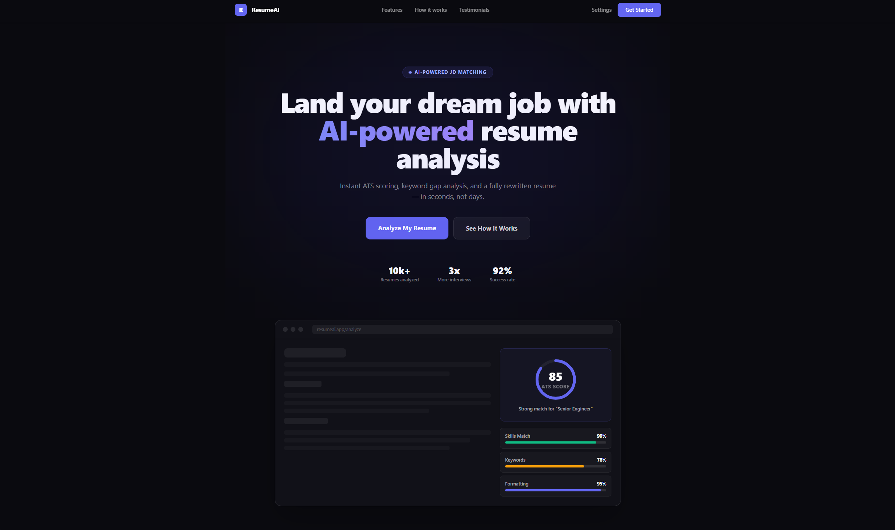
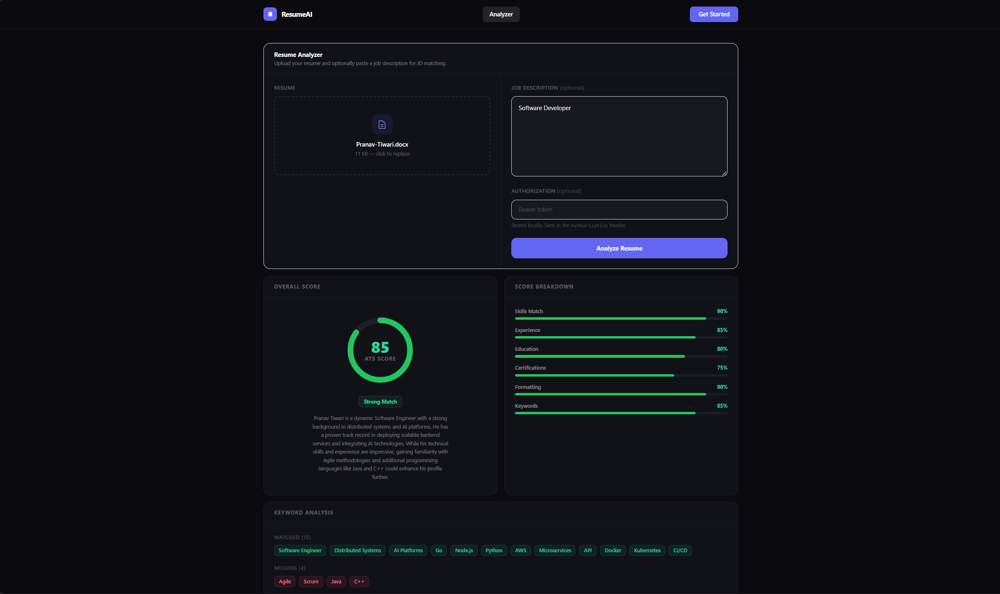
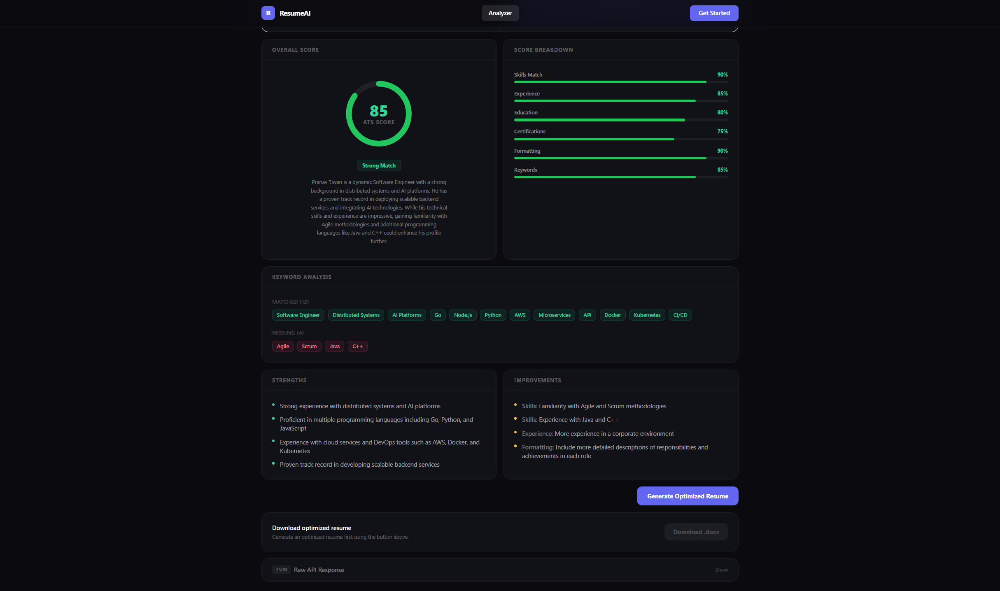
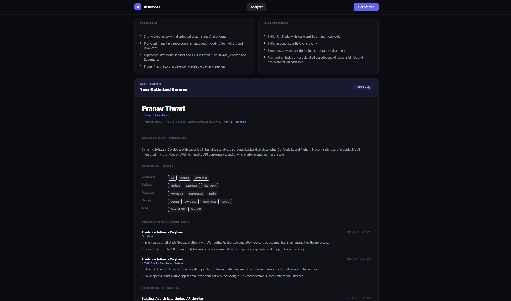
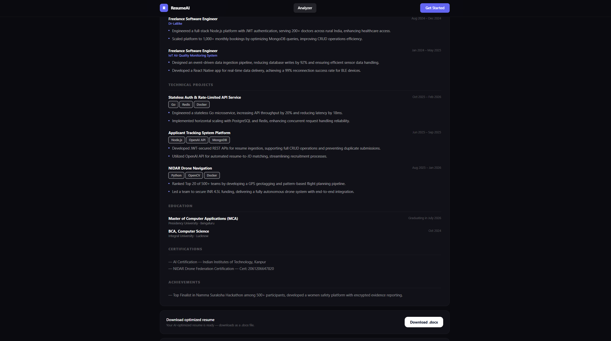

# 📄 Resume ATS Analysis Platform (Resume Club)


## Deploying the frontend

The frontend is deployed to GitHub Pages at https://prrrrnav.github.io/Applicant-Tracking-System-Analysis-Platform/.
The `Deploy to GitHub Pages` workflow publishes it whenever changes are pushed to `main`.
Set the repository Actions variable `VITE_API_BASE_URL` to the URL of a running backend API.
GitHub Pages hosts only the frontend; the API must remain available separately.

An intelligent, Dockerized Applicant Tracking System (ATS) simulator and resume analysis tool. This application allows users to upload their resumes (PDF or DOCX) to receive AI-powered summaries, formatting feedback, and actionable insights to improve their job application success rate.


## 🚦 Screenshots









## ✨ Key Features

* **Intelligent Parsing:** Extracts text seamlessly from both PDF and DOCX files using `pdf-parse` and `mammoth`.
* **AI-Powered Analysis:** Leverages the Groq API to evaluate resume content, generating summaries and ATS-compatibility scores.
* **Interactive Dashboard:** Beautiful, animated frontend built with Framer Motion and Recharts for visualizing resume metrics.
* **High Performance:** Utilizes Redis for caching analysis results, significantly reducing API latency and Groq token usage.
* **Export Capabilities:** Generate and download optimized resume documents directly from the browser.

## 🛠️ Tech Stack

**Frontend (Client)**
* React 19 & Vite
* TailwindCSS (Styling)
* Framer Motion (Animations)
* Recharts (Data Visualization)
* React Dropzone (Drag-and-drop uploads)

**Backend (Server)**
* Node.js & Express
* Groq API
* Redis / ioredis (Caching)
* Multer (File Handling)

**Infrastructure**
* Docker & Docker Compose

---

## 🚦 Prerequisites

Before you begin, ensure you have the following installed:


* [Docker Desktop](https://www.docker.com/products/docker-desktop/)
* An active [Groq API Key](https://console.groq.com/keys)
* [Docker Image address](https://hub.docker.com/u/prrrranv)

---

## 🐳 Running with Docker (Recommended)

This project is fully containerized. You can pull the pre-built image directly from Docker Hub or build it locally using Docker Compose.

### 1. Environment Setup (CRITICAL)
Your Groq API key must be provided securely as `GROQ_API_KEY`. **Never commit this file to version control.**

Create a `.env` file in the root directory of the project:
```bash
touch .env